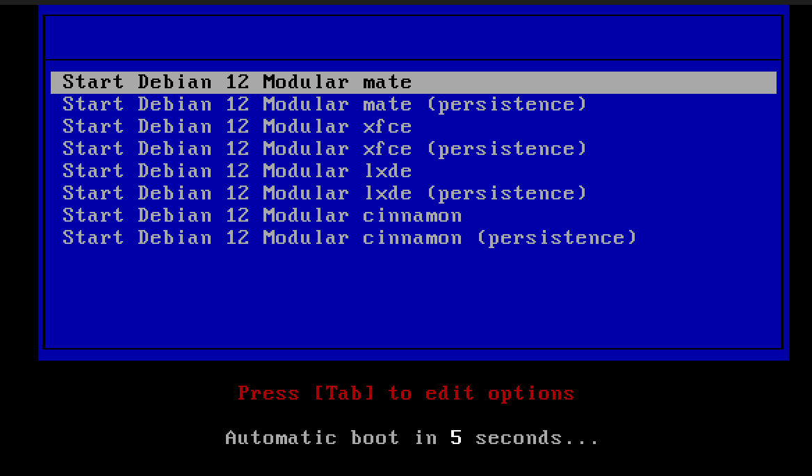

模块化 Debian 制作脚本

base + devtools + xorg + desktop(mate|kde|xfce|lxqt|lxde|cinamma)

### 生成步骤
```bash
# 安装必须的工具包
sudo ./build.sh prep
# 生成 base 模块
sudo ./build.sh base
# 生成开发工具模块
sudo ./build.sh dev
# 生成桌面基础模块
sudo ./build.sh xorg
# 生成桌面
sudo ./build.sh gui
# 制作 iso
sudo ./build.sh boot
```
### 生成结果
最终结果：生成带有 uefi 和传统启动方式的ISO文件
    target/debian-12-modular.iso

### 安装到硬盘
光盘ISO启动后，可以执行 sudo ./install.sh 安装到硬盘（需要提前分区）

### 启动截图


### 系统数据保存
persistence 默认保存在 Label 为 ldata 的硬盘分区。

persistence.conf
```conf
/   union,source=_debian/changes
```
